# Architecture

How the unified automation framework is put together: what talks to what, where code and data live,
how a test run flows from a command to a report, and where to extend it. Diagrams are Mermaid and render on GitHub.

- [1. System context](#1-system-context)
- [2. Package architecture](#2-package-architecture)
- [3. Test execution model](#3-test-execution-model)
- [4. Runtime: the Docker stack](#4-runtime-the-docker-stack)
- [5. Harbourline Bank (system under test)](#5-harbourline-bank-system-under-test)
- [6. Reporting](#6-reporting)
- [7. CI pipeline](#7-ci-pipeline)
- [8. Agents and MCP](#8-agents-and-mcp)
- [9. Configuration and secrets](#9-configuration-and-secrets)
- [10. Design decisions](#10-design-decisions)
- [11. Extending the framework](#11-extending-the-framework)
- [12. Known limitations](#12-known-limitations)

## 1. System context

One runner (Playwright Test) drives every channel: browsers, HTTP APIs, native Android through Appium,
and databases. Everything, including the Android emulator and the build, runs in Docker. The systems under test are either public demo apps, local containers, or your own environments.

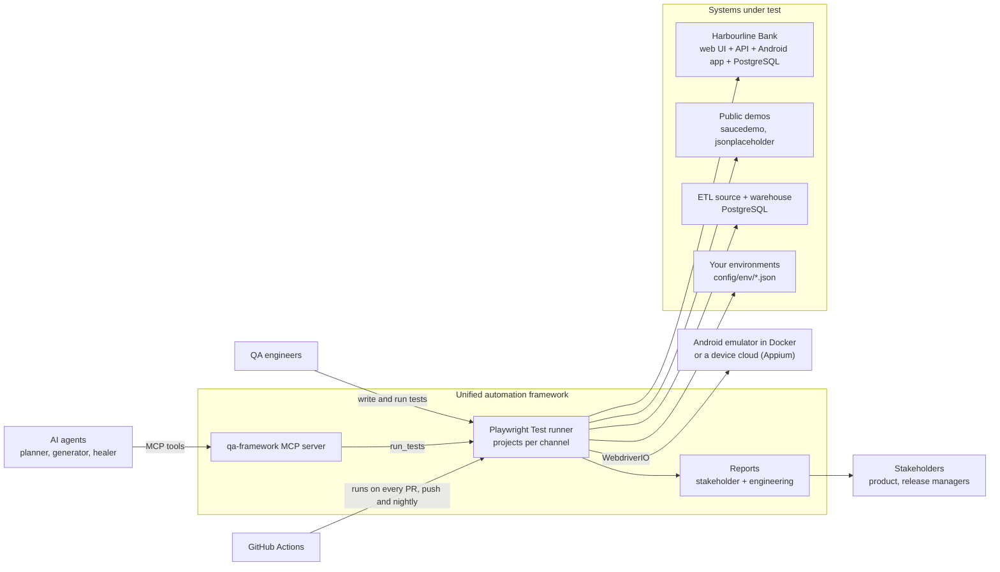

## 2. Package architecture

A pnpm workspace. Specs get fixtures **only** from `@qa/test`; the channel packages hide drivers and locators
behind page objects, clients and fixtures. Arrows point from a package to what it imports. Specs also import
types, builders and schemas directly (e.g. `PayeeBuilder` from `@qa/data`, `TransferSchema` from `@qa/api`).

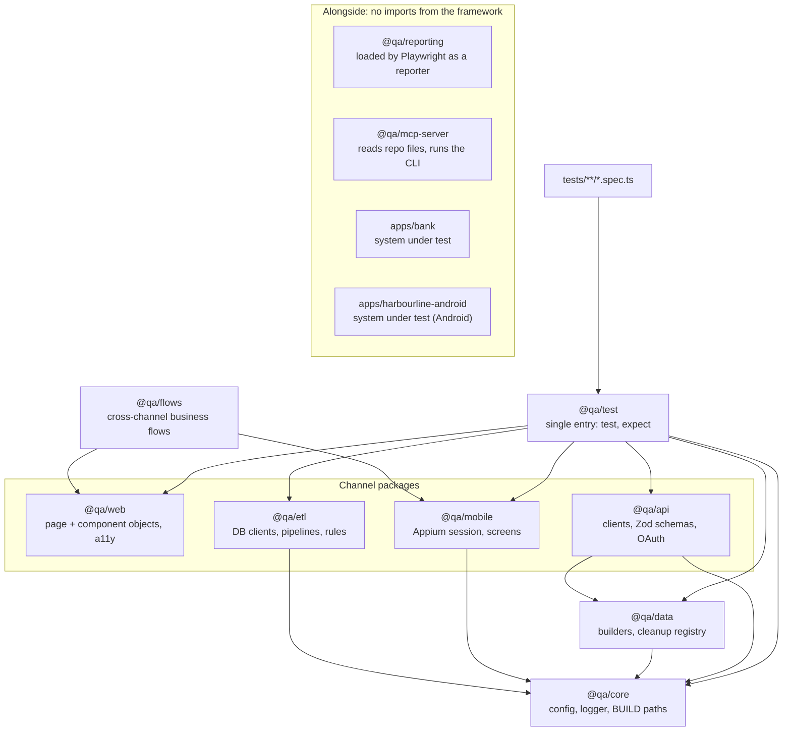

| Package          | Responsibility                     | Key contents                                                                                                                                                                                                                  |
| ---------------- | ---------------------------------- | ----------------------------------------------------------------------------------------------------------------------------------------------------------------------------------------------------------------------------- |
| `@qa/core`       | Configuration and shared constants | Zod-validated config (`config/env/<TEST_ENV>.json` + env overrides), `logger`, `BUILD` output paths, `AUTH` session files                                                                                                     |
| `@qa/data`       | Test data                          | `PostBuilder`, `OrderBuilder`, `PayeeBuilder`; `CleanupRegistry` (LIFO teardown)                                                                                                                                              |
| `@qa/web`        | Browser channel                    | `BasePage`, page objects (saucedemo, Harbourline; one class per file), components (`HeaderComponent`, `BankNav`), `toAud` money helper, `a11y` (axe) fixture                                                                  |
| `@qa/api`        | HTTP channel                       | `BaseClient`, service clients, `OAuthClient`, `BankTestSupport`, Zod contracts, `toMatchSchema` matcher, bank fixtures and health gate                                                                                        |
| `@qa/mobile`     | Native mobile                      | Lazy worker-scoped WebdriverIO session, device per project (`mobileDevice`), `BaseScreen`, Harbourline screens (`BankLoginScreen`, `AccountsScreen`, `TransferScreen`), Appium health gate, "not responding" dialog dismissal |
| `@qa/etl`        | Data channel                       | `DbClient` (Postgres adapter), `LocalPipeline` / `AirflowPipeline`, hash reconciliation, YAML rule engine, `bankDb`                                                                                                           |
| `@qa/flows`      | Business flows                     | One interface, one implementation per channel (e.g. login on web and mobile)                                                                                                                                                  |
| `@qa/test`       | Composition                        | `mergeTests` of every channel's fixtures + `config` and `cleanup`; `mergeExpects`                                                                                                                                             |
| `@qa/reporting`  | Stakeholder report                 | Playwright `Reporter` building a run model, HTML/Markdown renderers, trend history                                                                                                                                            |
| `@qa/mcp-server` | Agent interface                    | MCP tools over page objects, fixtures, configs, ETL rules, test runs                                                                                                                                                          |

**Locator policy:** `getByRole` > `getByLabel` / `getByPlaceholder` > `getByTestId` > CSS, never XPath;
locators live in page objects, never in specs. The order is a review rule. ESLint backs it up on specs:
raw locators are a warning, `waitForTimeout` and non-web-first assertions are errors. See [CODING_STANDARDS.md](CODING_STANDARDS.md).

## 3. Test execution model

Every channel is a Playwright **project**. Setup projects log in once and save the session so the web
projects start authenticated.

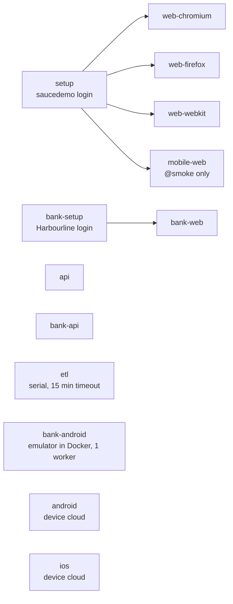

**Fixtures are lazy.** A spec gets only what it asks for: a web test never opens an Appium session or a
DB pool. Worker-scoped fixtures (DB pools, the Appium driver, the bank health check) are created once per worker.

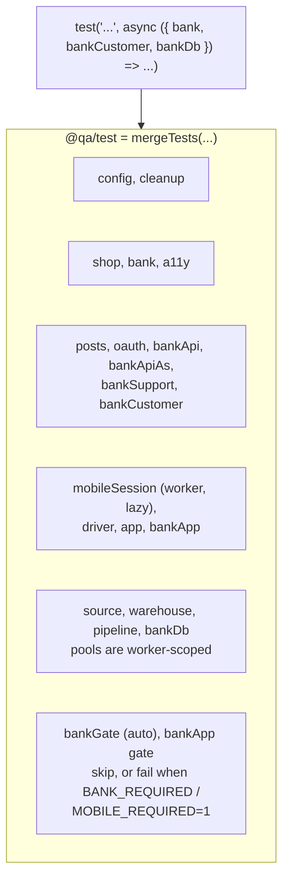

**Data isolation.** Tests that change state create their own data and remove it afterwards, so the suite
runs fully parallel. Example: a Harbourline transfer test through the UI.

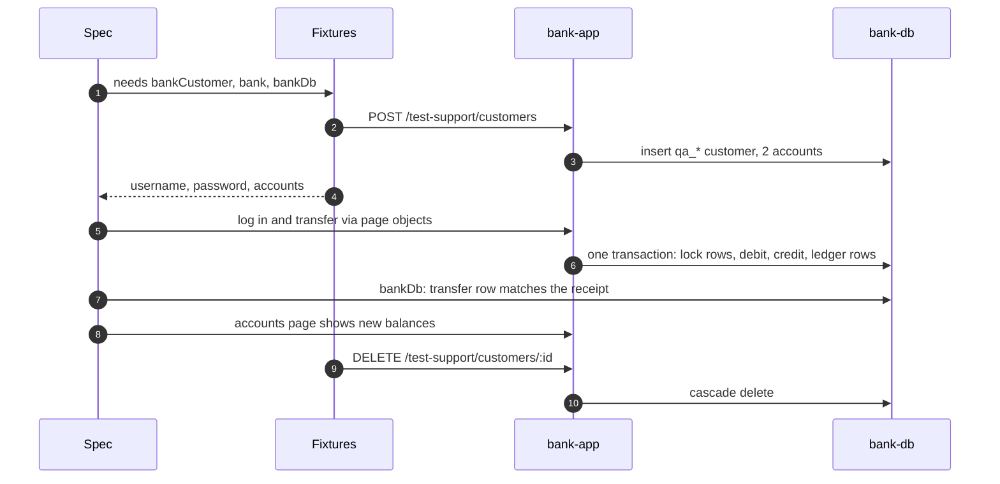

**Availability.** Bank, ETL and mobile fixtures skip a test with a reason when their system is down, so a
laptop without Docker (or without the emulator running) still runs the rest. CI and the Docker test runner set
`BANK_REQUIRED=1` and `MOBILE_REQUIRED=1`, which turn that skip into a failure: a job can never pass with
everything skipped. The mobile gate checks Appium's `/status` before any session is opened.

## 4. Runtime: the Docker stack

`compose.yaml` (project `qa-stack`) includes `docker/etl`, `docker/bank` and `docker/mobile` (profile `mobile`)
and adds the `tests` runner.
Containers talk by service name on the Compose network; host ports exist only for people and host-side runs.

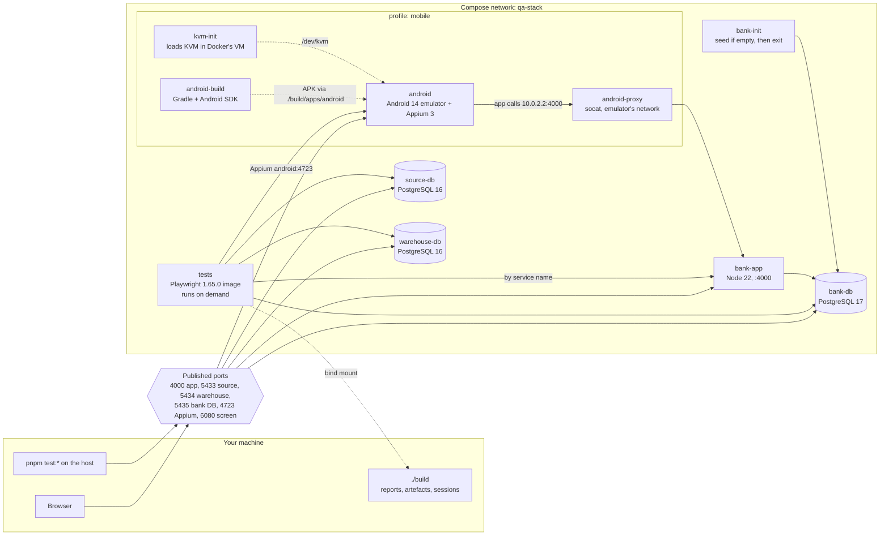

| Service                     | Image                                           | Host port  | Notes                                                                                                                         |
| --------------------------- | ----------------------------------------------- | ---------- | ----------------------------------------------------------------------------------------------------------------------------- |
| `bank-db`                   | `postgres:17`                                   | 5435       | Named volume `bank-data`                                                                                                      |
| `bank-init`                 | `harbourline-bank:local`                        | none       | Built once by `bank-app`; `--if-empty` keeps data across restarts                                                             |
| `bank-app`                  | `harbourline-bank:local`                        | 4000       | `apps/bank/Dockerfile`; app deps only from the workspace lockfile; runs as `node`                                             |
| `source-db`, `warehouse-db` | `postgres:16`                                   | 5433, 5434 | Seeded from `docker/etl/init/*.sql`                                                                                           |
| `tests`                     | `qa-tests:local`                                | none       | `docker/tests/Dockerfile`; profile `tests`; `BANK_AUTOSTART=0`, `BANK_REQUIRED=1`, `MOBILE_REQUIRED=1`, `APPIUM_HOST=android` |
| `android-build`             | `harbourline-android:local`                     | none       | `apps/harbourline-android/Dockerfile` (Gradle 8.10.2, JDK 17, SDK 35); copies the APK to `build/apps/android`                 |
| `kvm-init`                  | `alpine:3.20`                                   | none       | Privileged one-off: `modprobe kvm_intel/kvm_amd` in Docker Desktop's VM; no-op if `/dev/kvm` exists                           |
| `android`                   | `budtmo/docker-android:emulator_14.0_v3.9.0-p1` | 4723, 6080 | Nexus 4 profile (768x1280), 2.5 GB guest RAM (Android 14 minimum), 6 GB container limit, analytics off                        |
| `android-proxy`             | `alpine/socat`                                  | none       | Shares the emulator's network: forwards `:4000` to `bank-app`                                                                 |

Ports avoid a local PostgreSQL on 5432. `.dockerignore` keeps `.env`, `.git`, `node_modules`, `build/`,
`mobile-builds/` and editor settings out of every image.

## 5. Harbourline Bank (system under test)

A fictional bank in `apps/bank`, built so the framework has one realistic target exercising UI, API,
authentication and data together. It shares no code with the framework.

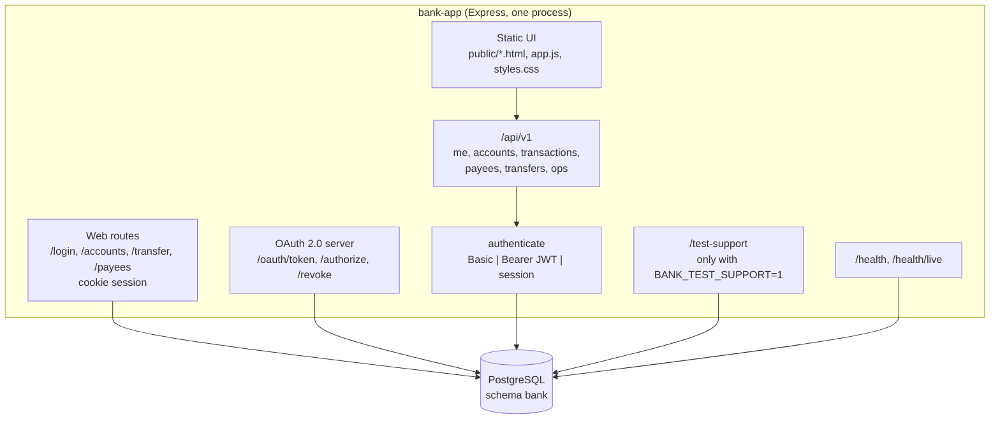

**Authentication.** Every `/api/v1` route accepts HTTP Basic, an OAuth bearer token (HS256 JWT, 15 min),
or the web session cookie (30 min). Refresh tokens last 7 days and rotate on use. Scopes are checked per route
(`accounts:read`, `payments:write`, ...). Another customer's resources return 404, not 403, so ids can't be
probed. Three wrong passwords lock a customer.

| Grant                            | Client                         | Notes                                     |
| -------------------------------- | ------------------------------ | ----------------------------------------- |
| `password`                       | `qa-automation` (confidential) | Customer token + refresh token            |
| `client_credentials`             | `ops-service`                  | Service token; only `/api/v1/ops/*`       |
| `authorization_code` + PKCE S256 | `harbour-mobile` (public)      | Sign-in and consent page; one-time codes  |
| `refresh_token`                  | confidential and public        | Rotating: the old token is revoked on use |

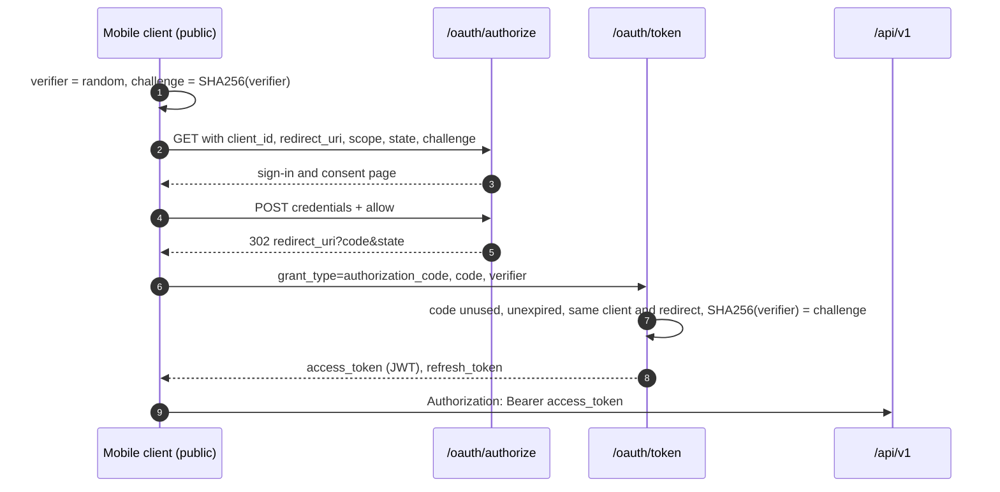

**Money movement.** `POST /transfers` runs in one database transaction: lock both accounts in id order,
check available funds and the daily payee limit, insert the transfer, update balances, write one ledger row
per side. An `Idempotency-Key` makes retries safe, including concurrent duplicates.

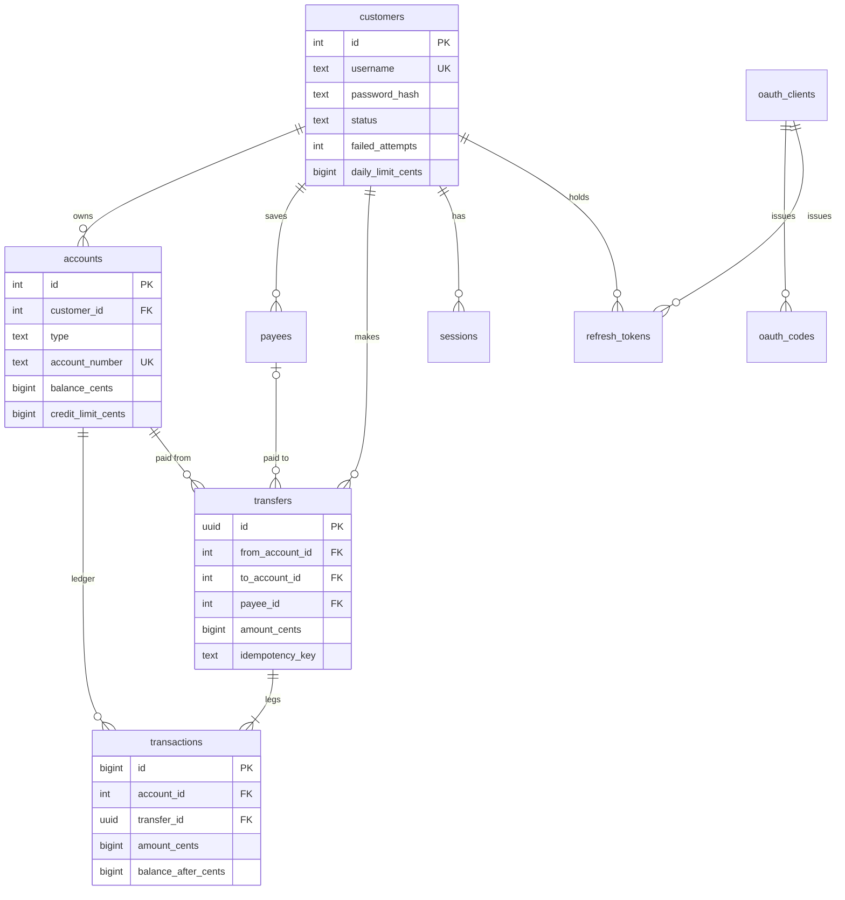

Invariants the tests check in the database: an account's balance equals the sum of its transactions, and
every internal transfer has exactly two legs summing to zero. Money is integer cents throughout.
Secrets (passwords, client secrets, refresh tokens, auth codes, sessions) are stored only as scrypt or SHA-256 hashes.

### Harbourline Mobile (Android)

`apps/harbourline-android` is a native Kotlin app (platform APIs only, no libraries) with three screens:
sign in, accounts, transfer between own accounts. It is a **public OAuth client** (`harbour-mobile`): it
submits the sign-in form to `/oauth/authorize` without following the redirect, reads the code from the
`com.harbourline.mobile://oauth/callback` redirect, and exchanges it with its PKCE verifier. Tests find
elements by Android resource id; content descriptions stay human for TalkBack.

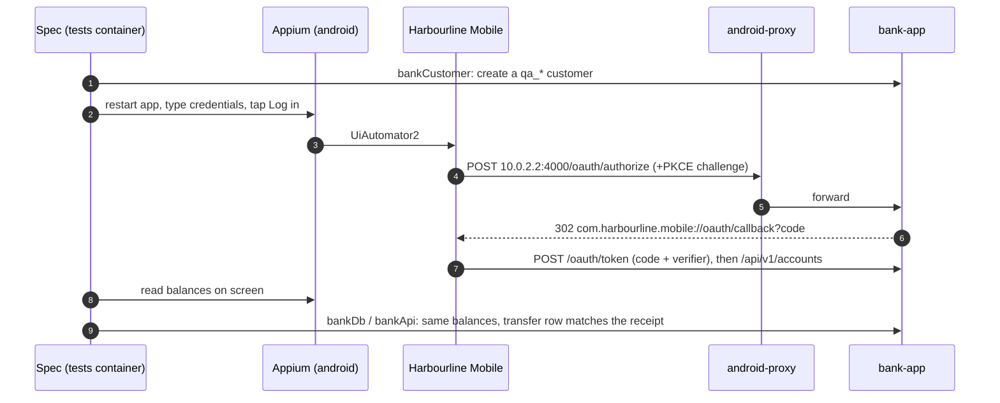

## 6. Reporting

Every run writes to `build/` (paths defined once as `BUILD` in `@qa/core`). The diagram shows a local or
Docker run. In CI each job writes only blob and Allure results (`build/reports/blob`, `build/reports/allure-results`),
and the report job renders both reports from the merged blobs ([section 7](#7-ci-pipeline)).

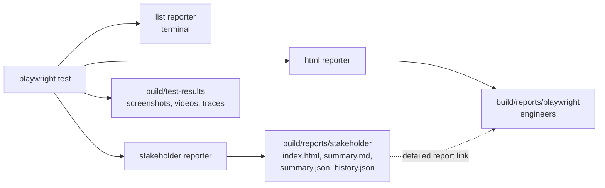

The stakeholder reporter turns results into a **run model**: counts, pass rate, release status, results
per product area (Playwright project) and per quality dimension (tags), failures, flaky tests, skip reasons.
It then renders one self-contained HTML page and a Markdown summary, and appends the run to `history.json`
(last 30 runs) for the trend chart.

| Release status   | Rule                                                        |
| ---------------- | ----------------------------------------------------------- |
| Not ready        | Any `@smoke` or `@security` failure, or pass rate below 90% |
| At risk          | Any other failure, or any flaky test                        |
| Ready to release | Everything executed passed                                  |
| No results       | Nothing ran                                                 |

The page is built for people who don't read test code: each status has an icon and a word next to its colour,
because red and green are nearly identical for deuteranopes. Every chart has a table view, light and dark themes,
and print styles. axe reports no WCAG 2 A/AA violations.

## 7. CI pipeline

`.github/workflows/tests.yml`. Every job runs in the same containers as locally; the runner needs only Docker.
Pull requests run `@smoke`; pushes to `main` and the nightly run do everything.

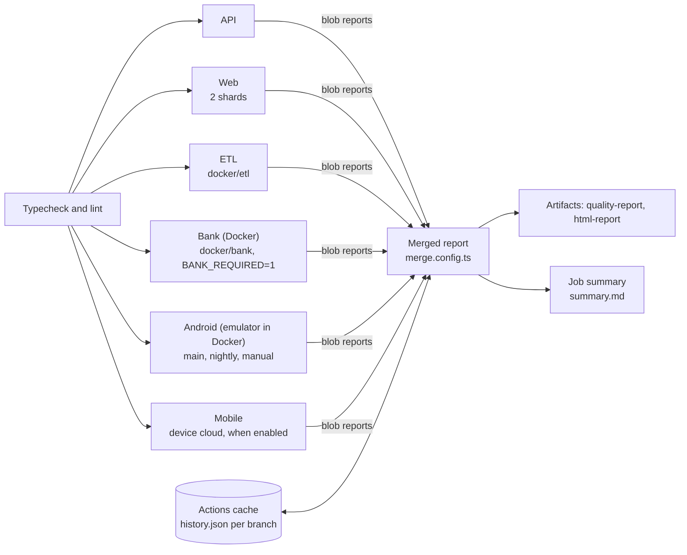

Images install dependencies with `--frozen-lockfile`. No secrets are needed until stage 2 (your own
environments); the staged rollout is in [CI.md](CI.md).

## 8. Agents and MCP

Agents work through MCP servers registered in `.mcp.json`. The framework's own server exposes this repo,
so generated tests use existing page objects and fixtures instead of raw locators.

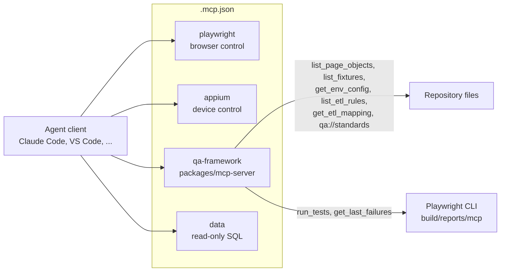

Guardrails: `run_tests` refuses production environments; secrets are redacted from `get_env_config`;
agent changes arrive as PRs labelled `ai-generated` with the same CI gates; the healer may change locators
and waits only. The `etl-test-generator` agent in `.claude/agents/` turns a mapping spec into rules and tests.

## 9. Configuration and secrets

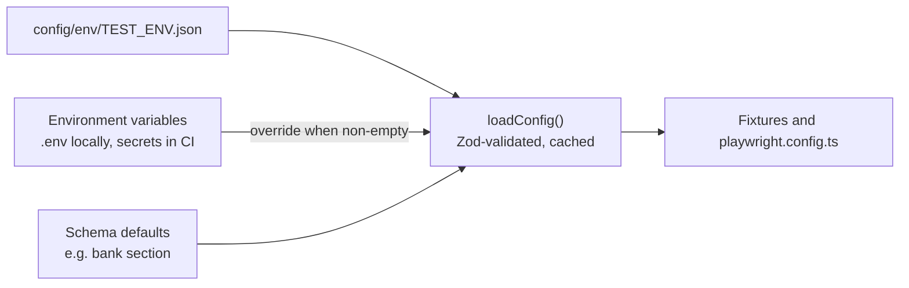

- `TEST_ENV` picks the file (`dev` by default). Environment variables override it; empty values are ignored,
  so unset CI secrets fall back to the file.
- `.env` is git-ignored and Docker-ignored. Only synthetic demo credentials live in `config/env/dev.json`.
- Harbourline's settings have local defaults (base URL, DB URL, OAuth clients), so no env file is needed for it.

## 10. Design decisions

| Decision                                                   | Why                                                                                         | Trade-off                                                                                                       |
| ---------------------------------------------------------- | ------------------------------------------------------------------------------------------- | --------------------------------------------------------------------------------------------------------------- |
| One runner (Playwright Test) for every channel             | One way to tag, retry, shard, report and debug; fixtures compose across channels            | Native mobile goes through WebdriverIO inside Playwright, not a mobile-first runner                             |
| Specs import only `@qa/test`                               | Fixtures are the API; drivers and locators stay swappable                                   | One more layer to learn                                                                                         |
| Lazy, merged fixtures                                      | A spec pays only for what it uses; parallel by default                                      | Fixture graph needs care (worker vs test scope)                                                                 |
| A local bank as the reference system under test            | Exercises UI, API, OAuth and data invariants together, offline and deterministic            | Extra code to maintain; it is not your real system                                                              |
| Each state-changing test owns its data (test-support API)  | Full parallelism, no cross-test interference, no shared fixtures to reset                   | Needs a gated test-only endpoint in the system under test                                                       |
| Skip locally, fail in CI when a system is down             | Laptops stay usable; CI can't go green by skipping everything                               | Two behaviours to understand (`BANK_REQUIRED`)                                                                  |
| Everything generated under `build/`                        | One folder to clean, cache, mount or upload                                                 | Paths must come from `BUILD`, not literals                                                                      |
| Self-contained stakeholder report                          | Email-able, offline, printable; independent of CI tooling                                   | Custom code instead of an off-the-shelf dashboard                                                               |
| Docker stack including the runner                          | Same versions everywhere; only Docker needed                                                | Image builds; the test image must match the Playwright version                                                  |
| Android emulator in Docker (budtmo/docker-android, pinned) | Android testing on Windows and Linux with no SDK installs; same in CI                       | Needs KVM (privileged `kvm-init` on Docker Desktop); software graphics, so a small screen and ~10 min cold boot |
| Our own native app instead of a demo APK                   | Mobile tests exercise the same bank, OAuth and data as web and API, checked in the database | Another app to maintain                                                                                         |

## 11. Extending the framework

**Point it at your own web app or API**

1. Add `config/env/<name>.json` and run with `TEST_ENV=<name>`; put secrets in `.env` / CI secrets.
2. Add page objects under `packages/web/src/pages/<app>/` and clients under `packages/api/src/clients/<app>/`,
   with Zod schemas. Keep **one class per file**: the MCP `list_page_objects` tool reports the first class in
   each file, so agents would not see the others.
3. Expose them as fixtures in the package's `fixtures.ts`; they appear in `@qa/test` automatically.
4. Add a Playwright project per channel and a friendly area name in `packages/reporting/src/stakeholder-reporter.ts`.

**Add a database platform** (SQL Server, Snowflake, ...): implement `DbClient` in `packages/etl/src/db.ts`
and route to it in `connect()`.

**Add a pipeline orchestrator** (ADF, Glue, dbt Cloud): implement `PipelineRunner` in
`packages/etl/src/pipeline.ts` and select it in `createPipeline()`.

**Add a quality dimension**: add a tag to `DIMENSIONS` in `packages/reporting/src/model.ts` and to
[CODING_STANDARDS.md](CODING_STANDARDS.md).

**Add a mobile app**: build it in Docker (see `apps/harbourline-android/Dockerfile`) or drop the APK in
`mobile-builds/`; add `config/devices/<name>.json`, screens under `packages/mobile/src/screens/<app>/` and a
fixture; add a project with `use: { mobileDevice: '<name>' }` and `workers: 1` per device.

**Add a containerised system under test**: add a compose file under `docker/<name>/`, include it from
`compose.yaml`, and add it to the `tests` service's `depends_on` and environment.

## 12. Known limitations

- Android in Docker needs an x86-64 host with hardware virtualization (Windows 11 + WSL 2, or Linux with KVM);
  Apple Silicon Macs can't run it locally. iOS simulators need macOS and can't run in Docker: use a device cloud.
- The emulator uses software graphics: the screen is kept at 768x1280, the first boot takes up to ~10 minutes,
  and larger profiles exceed Docker Desktop's default 8 GB VM. One emulator means one mobile worker.
- `kvm-init` runs privileged against Docker's VM; acceptable for local and CI machines, not shared hosts.
- The stakeholder page's link to the engineering report works when the file is opened from disk or from the
  CI artifact, not through `pnpm report:stakeholder`, which serves only the stakeholder folder.
- Reports from the Docker runner show no branch or commit, because `.git` isn't copied into the image.
- The CI trend history lives in the Actions cache, which GitHub evicts after 7 days without use.
- Only a PostgreSQL `DbClient` and the local and Airflow pipeline runners exist today.
